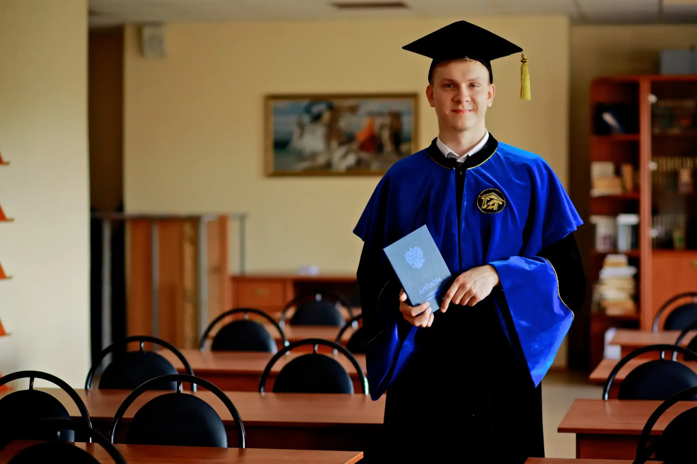

## Биография

Антон Владиславович Назаров родился и вырос в Москве. Большую часть взрослой жизни он занимается информационными технологиями. В разные годы он создавал и развивал внутренние системы для организаций, налаживал работу IT-служб, руководил небольшими командами, разбирал сложные рабочие процессы и переводил их из бумажного или ручного вида в более удобный цифровой.

Его работа постепенно менялась от непосредственного программирования и технической поддержки к более широким задачам: понять, как устроена организация, где сотрудники теряют время, какие сведения нужны руководству, как связать между собой разные участки работы и как сделать новую систему понятной людям, которым предстоит ею пользоваться.

В конце сентября 2022 года Антон переехал из Москвы в Белград. После переезда стал в основном работать самостоятельно как предприниматель и консультант по цифровым системам, одновременно включившись в местную общественную жизнь.

## Школьные годы и ранние увлечения

Антон окончил московскую школу № 1350, ранее № 817, в 2006 году. В 10–11 классах участвовал в школьном самоуправлении: был министром информации, занимался школьной газетой и сайтом, писал статьи и помогал организовывать концерты, выступления и другие школьные события.

Музыкой занимался со школьных лет. Одна из первых школьных групп позднее стала группой **«Быторезы»**. Затем Антон пел в металлической группе **«Обсидиан»**, участвовал в нескольких экспериментальных составах, в том числе с элементами регги. Примерно с 2011–2012 годов периодически участвовал в записях и выступлениях Милы Киреевской и проекта **«Тайная летопись»**. Около 2014 года вернулся к занятиям вокалом и пел в современном хоре, где исполняли в том числе произведения Metallica и Pink Floyd.

Летом 2006 года вместе с палеонтологами исследовал пещеры в районе Домодедово. Около 2010 года ездил с палатками и рыбалкой на Сямозеро.

## Образование

В 2006–2008 годах Антон учился в московском **Коммерческом банковском колледже № 6** по специальности «Экономика и бухгалтерский учёт по отраслям».

В 2011 году начал обучение в **Гуманитарном институте** по направлению, связанному с применением информатики в экономике. После перерыва вернулся к учёбе в 2017 году. В 2019 году перевёлся в **Национальный институт бизнеса** и окончил его как бакалавр менеджмента со специализацией, связанной с управлением малым бизнесом.

В том же 2019 году прошёл профессиональную переподготовку по управлению информационными технологиями. В разные годы также учился программированию, организации IT-служб, переговорам, управлению продуктами, организации мероприятий и продвижению. В 2026 году получил **Airtable Builder Certification** от Airtable Academy и прошёл **n8n Quickstart** в n8n Academy.

*Получение диплома Гуманитарный институт — 29.06.2019.*

## Работа и профессиональный путь

### 2008–2012: первые годы

В сентябре 2008 года Антон начал работать в [аэропорту Домодедово](/places/domodedovo-airport/), пройдя внутреннее обучение и отбор из группы 12 кандидатов. Он занимался внутренними программами для сотрудников, электронным документооборотом, исправлением ошибок, тестированием изменений и помощью пользователям.

В 2009–2011 годах параллельно вёл частную техническую практику: делал и поддерживал сайты, настраивал серверы и компьютеры, устанавливал программы и автоматизировал резервное копирование. В 2011–2012 годах работал с внутренним документооборотом в **ООО «Фирма АйТи. Информационные технологии»**: переводил часть внутренних приложений в браузерный вид и проводил вводные занятия для новых сотрудников. В конце 2012 года выполнил короткий проект для сервисного бизнеса.

### 2013–2017: банк и внутренние системы организаций

С января 2013 по сентябрь 2015 года Антон работал в **АО КБ «Банк Расчётов и Сбережений»**. ООО «Русская юридическая компания Холдинг-Финанс», указанное в выписке СФР как работодатель большей части этого периода, было связанным с банком юридическим лицом. Вместе с руководством и сотрудниками Антон разбирал, как проходят документы по банку, кто их создаёт и согласовывает, где возникают задержки. На этой основе была создана новая внутренняя система документооборота, которой пользовались около 60 сотрудников back office. Она уменьшала ручную работу, делала видимыми ответственных и сроки обработки и связывала несколько используемых банком систем. Антон также обучал сотрудников и курировал работу другого программиста.

С 31 октября 2016 по 17 марта 2017 года Антон работал в **Торговом Доме «Синергия Маркет»**, входившем в группу «Синергия». В современной выписке СФР это юридическое лицо указано под более поздним наименованием ООО «Новабев Маркет». Антон приводил в порядок существующую Domino-систему документооборота с несколькими тысячами пользователей и накопившиеся запросы на исправления и улучшения.

### 2017–2023: московская сфера культуры

С января 2017 по май 2023 года Антон работал в **Дирекции культурных центров Москвы**. Это был самый длинный этап его работы в одной организации. Он занимался развитием внутренних информационных систем, отчётностью, обучением пользователей, техническими вопросами и координацией работы с учреждениями культуры.

Главной задачей стало развитие большой городской системы, через которую учреждения могли вести сведения об организациях, помещениях и мероприятиях, заполнять анкеты и отчёты, пользоваться общими справочниками и картой. С ней работала сеть более чем из **100 учреждений**. Поэтому значительную часть работы составляли не только изменения самой программы, но и инструкции, вебинары, разбор вопросов пользователей и общение с местными IT-службами.

Одним из заметных результатов стала переработка сложной отчётности: отчёт, формирование которого раньше могло занимать около пяти часов, после изменений стал строиться за время от нескольких секунд до нескольких минут в зависимости от объёма данных.

### 2019–2022: руководство IT-службами

С сентября 2019 по март 2020 года Антон одновременно работал в **МАСР — Московском агентстве социального развития**. Организация была новой, поэтому IT-службу фактически приходилось создавать с нуля: организовывать рабочие места и связь, учитывать технику, настраивать доступ сотрудников, закупки, безопасность и поддержку пользователей. Антон также участвовал в приёмке городских проектов «Здоровая Москва» и «Мой социальный центр».

С марта 2020 по июнь 2022 года он возглавлял **IT-отдел Культурного центра ЗИЛ**. В его ведении находились около 200 рабочих мест, серверы, сеть, телефония и видеонаблюдение. Команда выросла с трёх до пяти штатных IT-специалистов; кроме неё Антон руководил двумя инженерами по монтажным работам.

В ЗИЛ была создана единая служба приёма заявок и автоматизирован учёт техники. Во время пандемии более **100 сотрудников** перевели на удалённую работу. Одновременно обновлялись рабочие места и видеонаблюдение, проводилась инвентаризация и пересматривались внутренние правила работы IT-службы.

### 2022: внедрение систем в коммерческих компаниях

С августа по ноябрь 2022 года Антон работал в компании **«Новая деловая среда»**. Основная задача состояла в том, чтобы понять, почему сотрудники клиентов не всегда начинали пользоваться уже внедрёнными системами так, как ожидалось. Он занимался организацией внедрения, распределением ответственности, общением с клиентами и поддержкой после запуска.

### С 2022 года: Сербия и самостоятельная практика

После переезда в Белград Антон начал собственную практику. Он работал с небольшими компаниями, общественными и образовательными проектами, сервисными бизнесами и командами из разных стран.

Основные направления этой работы — учёт клиентов и заявок, бронирования и расписания, внутренние кабинеты сотрудников, отчётность, автоматические уведомления, работа выездных специалистов, учёт оборудования и обслуживания, опросы и тестирование, каталоги и небольшие торговые площадки. В нескольких проектах приходилось переносить большие архивы документов и приводить разрозненные данные к единой структуре.

Отдельное направление последних лет связано с практическим применением искусственного интеллекта: разбором и проверкой информации, обработкой документов, подготовкой материалов и помощью в разработке. Эти задачи продолжают ту же линию работы — превращение сложного ручного процесса в более понятный и управляемый.

В 2023 году Антон также преподавал в **OTUS Online Education**, рассказывая о создании веб-приложений, дизайне интерфейсов, использовании нейросетей и работе на международном рынке удалённых услуг.

В 2026 году развивал публичный справочник **«Инструкция по Сербии» (rslive.ru)**, посвящённый практическим вопросам жизни в Сербии.

## Общественная и творческая деятельность

### Поэзия и литературное творчество

Антон публикует стихотворения и тексты авторских песен. Первые доступные публикации в его [авторском профиле на «Стихи.ру»](https://stihi.ru/avtor/lzlis) относятся к августу 2007 года. В архиве представлены философская, любовная и гражданская лирика, сатирические и иронические стихи, авторские песни, а также пьеса «Сценарий масленицы». По состоянию на 20 октября 2026 года в профиле опубликовано **106 произведений**. Среди них — «В себе» (2007), «Фантом» (2008), «Идея поколения» (2019) и «Мы вечно куда-то несёмся» (2026).

### Фестивали, музыка и танцы

С 2009 года Антон регулярно ездил на музыкальные, этнокультурные и альтернативные фестивали. Первым крупным таким событием для него стали **«Пустые холмы»**. В 2012 году он впервые приехал на фестиваль **«Быть Добру»** как волонтёр, а с 2014 года вошёл в организаторскую команду.

В 2014–2015 годах Антон участвовал в организации **«Быть добру»**, где отвечал в том числе за ярмарку и небольшую волонтёрскую команду. Сам Антон связывает эту работу с Суворово / районом Суворова на границе Тульской и Калужской областей, хотя публичная хроника отдельных выпусков 2014–2015 годов указывает другие площадки. В 2016 году был волонтёром на фестивале в Крыму и в тот же фестивальный период побывал на **«Квамманге»**.

Во второй половине 2010-х Антон регулярно сотрудничал с группой **«Полынья»**. В 2017–2020 годах занимался организацией концертов: работал с площадками, продвижением, страницами мероприятий и онлайн-продажей билетов, поддерживал официальный сайт и социальные сети группы. Среди подтверждённых концертов, относящихся к его организаторской деятельности, — выступления в московских «Доме Белого Журавля» и «Китайском лётчике Джао Да». Концерт в «Массолите» 26 января 2020 года организовывал не Антон. Позднее он участвовал в записи сингла **«Фруктовая»**, вышедшего в 2024 году, и записал подкаст с Ольгой Безлюдовой и Анастасией Уткиной.

В Москве в 2020–2022 годах Антон занимался **спортивным хастлом / дискофоксом** в клубе **YouDance**, участвовал в десятках соревнований и неоднократно занимал призовые места. Его профиль в базе Ассоциации спортивного хастла — [АСХ #11713 на Radio Hustle](https://radiohustle.online/dancers/11713); по состоянию на 14 октября 2026 года профиль отмечен как прошедший верификацию, а на странице указаны **D0 / RS0**, **E: 5** и **BG: 13**. Прошёл обучение по тренерской программе и участвовал в танцевальных выездах клуба в 2020 и 2021 годах.

После переезда в Белград Антон включился в русскоязычное сообщество социальных танцев. С октября 2022 года участвовал в организационных встречах, поиске площадок и продвижении хастла. С 21 июня 2024 года вместе с другими участниками развивал регулярные открытые танцевальные встречи **OpenAir Belgrade** на набережной: занимался звуком и музыкой, анонсами, координатами и сбором донатов, позднее — цифровым приложением для сообщества. Со временем рядом с хастлом появился West Coast Swing; с 2025 года WCS стал основным направлением его собственной танцевальной практики.

21 января 2023 года Антон и [Анна Татаринцева](/people/2000-2009/anna-tatarintseva/) зарегистрировали брак в [Звездаре](/places/zvezdara/). 18 сентября 2023 года в [Земуне](/places/zemun/) родился их сын [Леонард](/people/2020-2029/leonard-nazarov/). С 16 января 2025 года Анна и Леонард живут в [Новочеркасске](/places/novocherkassk/) Ростовской области.

В 2025 году Антон стал одним из ключевых организаторов **Русской Масляницы в Белграде** на [Аде Циганлии](/places/ada-ciganlija/). Он участвовал в переработке концепции праздника, написал новый сценарий театрализованной программы и работал над общей программой вместе с командой организаторов. Праздник собрал более **500 гостей**.

10 февраля 2026 года брак Антона и Анны был официально расторгнут.

## Источники

- [Профессиональный архив Antiokh/CV](/sources/anton-nazarov-cv/) — образование, профессиональная хронология, роли и результаты работы.
- [Сведения СФР о трудовой деятельности](/sources/sfr-anton-nazarov-work-history-2024/) — официальные периоды занятости и должности.
- [Экспорт MyHeritage: Антон Назаров](/sources/myheritage-anton-nazarov-export/) — генеалогические данные, семейные связи и исходный портрет.
- [Личная биографическая хронология Антона Владиславовича Назарова](/sources/anton-nazarov-personal-history/) — образование, ранние увлечения, профессиональные уточнения, переезд, семейные события и общественная деятельность.
- [Архив концертов группы «Полынья»](/sources/polynia-concert-archive/) — сверка концертных дат и площадок.
- [Radio Hustle — Назаров Антон Владиславович, АСХ #11713](/sources/radiohustle-anton-nazarov-11713/) — публичная верифицированная карточка танцора и опубликованные показатели АСХ.
- [Стихи.ру — Назаров Антон (lzlis)](/sources/stihi-anton-nazarov-lzlis/) — опубликованные стихотворения, тексты песен и сведения об авторском профиле.
